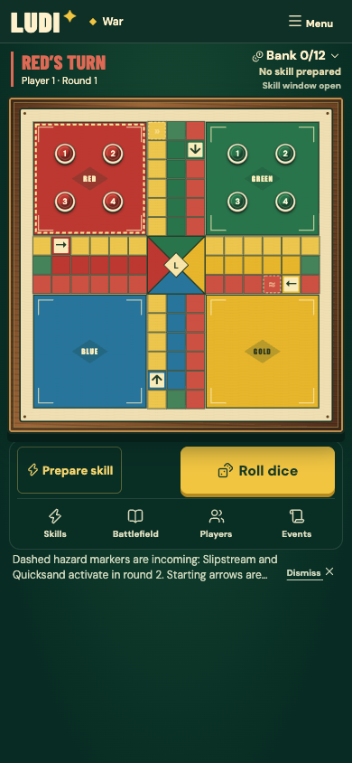
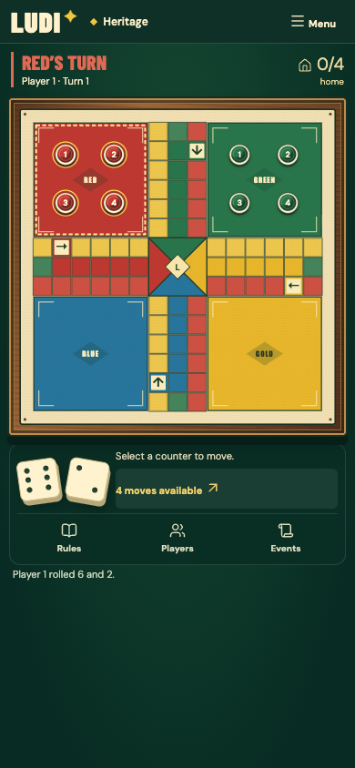
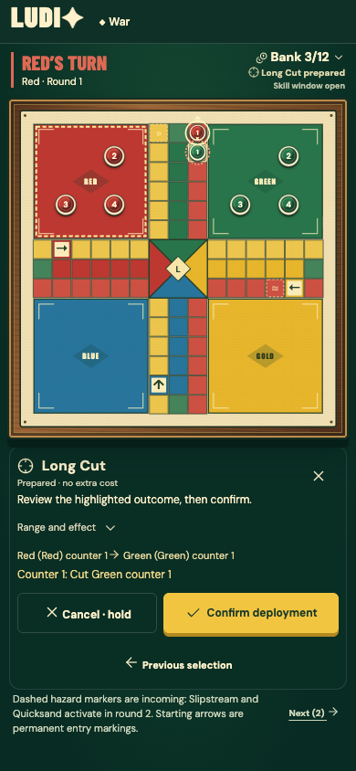
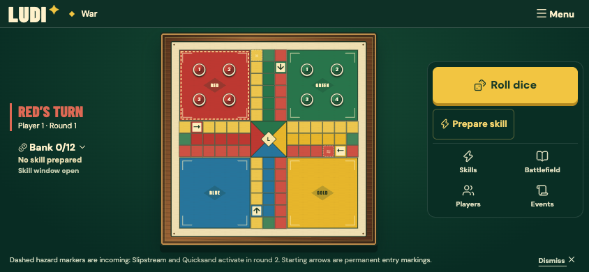

# LUDI Build 004A — local review

Implemented on the existing `main` branch. **Build 004A is deployed and verified** at https://ludi.allencreativetechnologies.uk. See [release details](RELEASE.md) for the final polish and live verification.

Open the local application at http://127.0.0.1:5173. Choose Play → Heritage or War → Local or Solo. The local production Worker at http://127.0.0.1:8787 also supports Online rooms while it is running.

## What changed

- A separate mobile composition replaces the compressed desktop dashboard. Both modes use the same existing board, counters, geometry, animations, action handlers and game state.
- Compact branding and mode header; current colour/player and turn/round; War Bank, skill window and prepared status remain visible.
- The wooden board occupies 96% of portrait width. No separate mobile board or geometry was introduced.
- The dock shows Roll Dice / Prepare or Deploy before rolling, dice and legal-move access after rolling, and waiting information during opponent turns. Move allocations open in a sheet; ambiguous board landings open the appropriate choices automatically.
- Skills, Players, Battlefield, Match Events and Match Rules use reusable native-dialog bottom sheets. Escape, focus containment and focus restoration work. Backdrop taps do not discard selections or confirmations.
- Deployment closes the skills catalogue and puts targeting below the visible board. Legal target/landing squares are highlighted from the existing legal skill actions; unavailable counters are dimmed while choosing. Invalid selections explain why they fail. The dock supplies selected counters, outcome, range/effect help and explicit confirmation. Short phones scroll targeting within the dock.
- The existing event queue keeps important messages and history; mobile renders a smaller event strip without covering the board.
- Phone landscape uses status / board / controls columns. Dynamic viewport units, existing safe-area padding and zoom support are preserved.
- Desktop retains its existing console and board composition. The shared skill panel now disables unavailable deployment and distinguishes purchase confirmation from targeting.

No new changes were made to game rules, dice generation, costs, economy, turn progression, server authority, Worker routing or Durable Object deployment in this UI build. Pre-existing uncommitted gameplay and deployment work was preserved.

## Browser verification

Chrome phone emulation, touch enabled, using the actual application:

| Viewport | Heritage / War board width | Ordinary gameplay page scroll |
|---|---:|---:|
| 375 × 667 | 360 px | None |
| 390 × 844 | 374 px | None |
| 393 × 852 | 377 px | None |
| 430 × 932 | 413 px | None |
| 844 × 390 landscape | 312 px | None |
| 667 × 375 landscape | 297 px | None |

Both before-roll and genuine after-roll states were checked. No horizontal overflow was detected. Desktop was viewed at 1440 × 1000. Full measurements are in `viewport-results.json`.

Actual interactions checked:

- Heritage and War local start, dice, counter/move selection, player/rules/event sheets and landscape controls.
- Guard Up purchased through normal local play, a counter selected on the board, phone rotated both ways with the selection retained, and deployment confirmed.
- Long Cut checked in an isolated, temporary browser fixture using the unchanged game engine: purchase, invalid Yard selection, reachable target squares, opponent selection, preview and confirmation; points charged only on purchase. The fixture is not part of the application or production bundle.
- Two mobile browsers against the local production Worker: create/join/ready/start, server authority, synchronized turns, guest reload recovery and orientation continuity in both modes.
- Existing two-client room smoke checks, including reconnect and changing rooms.
- Narrow 320 px phone, 150% text adjustment, keyboard Tab containment in sheets, Escape and focus restoration.
- No JavaScript errors in the completed browser checks. Repeatable dice were supplied only inside isolated browser checks where needed; application randomness was not modified.

`npm test`: **56 passed**. `npm run build`: **passed**, including TypeScript. `git diff --check`: **passed**.

This verification used Chrome emulation, not physical iPhone / Safari hardware. Physical-device safe-area and browser-chrome behaviour remains a useful review before production approval. It is not a production load test.

## Screenshots

Open `index.html` for the screenshot gallery. These are browser captures of the local implementation; they are not the supplied design reference.

### War portrait

### Heritage portrait

### Targeting

### Landscape

## Reference comparison · 22 October 2026

Reopened the implementation in Chrome and visually compared fresh 390 × 844 portrait and 844 × 390 landscape captures with the supplied reference. The reference is a layout and interaction guide, not a replacement board or rules specification.

- The compact header/status, dominant board, contextual dock, secondary sheets and optional side-by-side landscape layout follow the reference’s hierarchy.
- The existing SVG board geometry, wooden frame, counter artwork, colours and Barlow Condensed / DM Sans typography remain in use. Both portrait boards measured 374 px at a 390 px viewport (96%).
- Skill names and first-purchase prices were checked against the imported game definitions. Runtime costs continue to use the existing cost function, including price escalation. Long Cut retains its actual four-connected-track-space reach, rather than the illustrative range in the image.
- Battlefield information retains the actual Slipstream, Quicksand, Danger Tile and Heaven Lock rules. Illustrative Explosion, Storm and Vortex hazards were not introduced.
- Heritage omits Skills and Battlefield controls. Rotating either mode preserved counter positions. No browser JavaScript errors were observed.

Fresh captures: `reference-check-war.png`, `reference-check-heritage.png`, `reference-check-skills.png`, and the corresponding landscape captures. No further game-code changes were needed for this clarification. No deployment or push was performed.

## Lucide icon addendum

Interface glyphs now use the shared Lucide icon system on desktop and mobile, with named imports, consistent stroke weight, labelled controls, visible selection checkmarks and accessible icon-only actions. The board artwork, wooden frame, dice faces, counters, typography and actual hazard symbols remain unchanged. The screenshot gallery has been refreshed with the icon update. See [Lucide implementation and checks](LUCIDE.md).

## Review and deployment

The approved Build 004A release uses the existing Cloudflare account, Worker, Durable Object binding and custom domain. No unrelated DNS, websites, applications or Microsoft 365 services were modified. Earlier local-review notes above describe the pre-release review stages; current release status is recorded in RELEASE.md.
